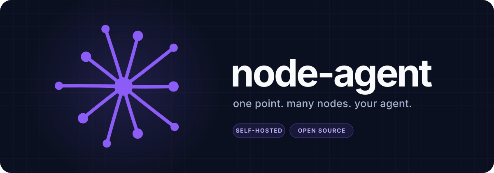
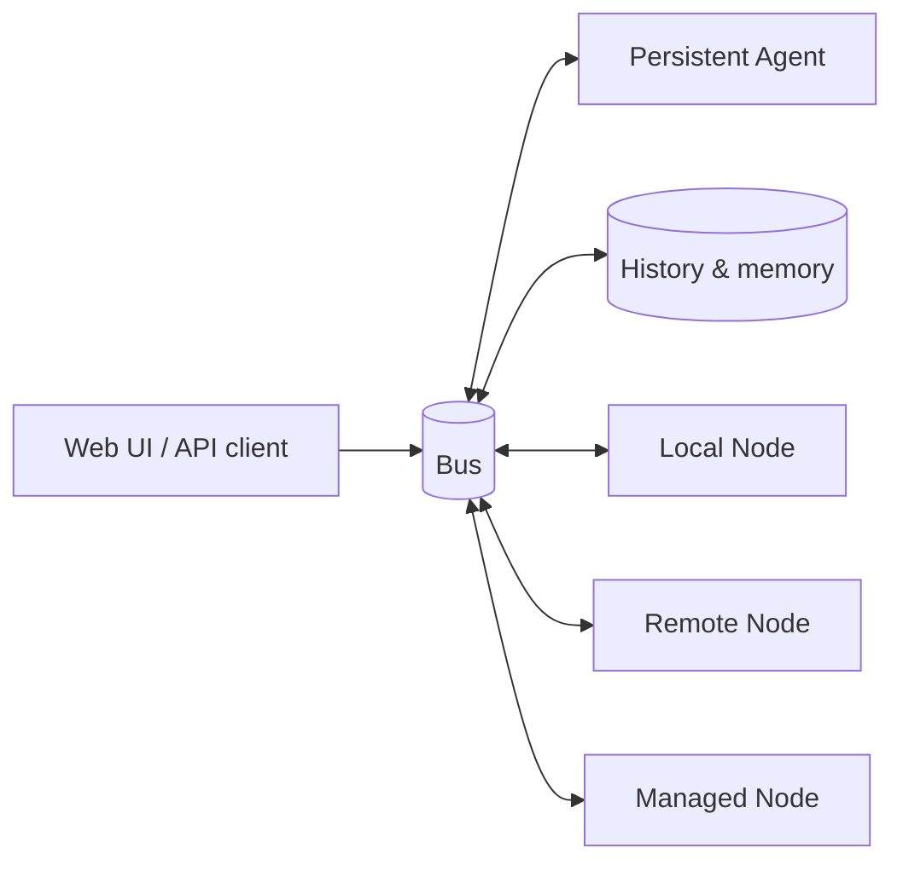

# NodeAgentOS

[English](README.md) | [中文](README.zh-CN.md)



**An operating system for a persistent agent.** One agent, one continuous session, and a bus that
lets Nodes join from anywhere. It runs on your laptop today, and the same runtime contract is built
to grow into a multi-tenant cloud service.

## 1. Setup

Node 23.6 or newer (`.nvmrc` and CI use 24) and npm.

### a. npx

```bash
npx @node-agent/local
# open http://127.0.0.1:8790/
```

### b. Docker

```bash
# local: the stack alone, on 127.0.0.1:8790
cp deploy/env.example deploy/.env                         # put a token in it
docker compose -f deploy/docker-compose.yml up -d --build

# public: the same stack, plus Caddy on 80/443 with a certificate
# (needs NODE_AGENT_ACCESS_TOKEN and NODE_AGENT_DOMAIN in deploy/.env)
docker compose -f deploy/docker-compose.yml --profile public up -d
```

## 2. Why NodeAgentOS

### 2.1 One agent, one continuous session

NodeAgentOS is built around a single agent, not a chat product with one assistant per tab.

- **One session.** There is no per-chat workspace and no per-task fork of the agent. Every page,
  message and timer talks to the same agent, with the same memory and the same working context.
- **One identity.** Notes, todos, history, tools and permissions belong to that agent, not to a
  temporary conversation.
- **Always serving.** The agent keeps serving across pages and restarts: it can wake on a timer,
  receive a message from a Node, or continue a task after the UI closes.

This is the difference between opening a chat window and having an assistant that is always there.

### 2.2 Designed for the cloud

A personal agent that is available 24/7 cannot live on a laptop that sleeps. It needs to run in the
cloud — always on, reachable from anywhere, and isolated from every other user. NodeAgentOS is
designed around that requirement, not around a local demo.

- **Every component is a service.** The bus, the runtime, the agent and its Nodes are separate
  processes with explicit contracts. They can run on one machine for development, then move to
  separate hosts without changing the model.
- **Multi-tenant by construction.** A user is an access relation, not a global singleton. The same
  runtime is meant to host many users, each with a persistent agent and a separate set of Nodes.
- **Network-first.** Nodes reach the agent over the network, not through in-process imports. A Node
  can live in another container, another datacenter, or another company's infrastructure.
- **Always serving.** Timers, incoming Node events and unfinished work continue even when no browser
  is open.

### 2.3 Nodes are network services

The unit of extension is a **Node**: a small package that exposes capabilities to the agent.

- **Isolated by default.** Every Node is its own process or worker and reaches the rest of the system
  only through one protocol on the bus. Nodes do not import each other, share memory or call private
  internals. An isolated Node can fail, restart or move without taking the agent down.
- **Many devices, many apps.** A desktop, a laptop, a phone or an application backend can each join
  as a Node over WebSocket. The agent sees them as capabilities, not as code it has to embed.
- **Bidirectional.** The agent can call a Node capability, a Node can call another Node, and a Node
  can push an event back to the agent.
- **Continuously extensible.** A Node declares its capabilities in its manifest. The agent discovers
  that manifest at runtime, so adding a device or an application never means rebuilding the core.

This is what keeps the system extensible without turning the agent into a monolith.

### 2.4 OS-level interfaces

A useful operating system does not only run programs; it gives them stable surfaces. NodeAgentOS
uses the same idea for agent extensions:

| surface | what it provides |
|---|---|
| **UI** | Nodes can contribute pages, panels and actions; the host owns routing, layout and the shell. |
| **i18n** | Nodes ship their text as a resource; the runtime resolves the reader's language, and every surface follows it. |
| **Persistence** | Transcripts, notes and long-lived state go through the runtime and history layer, not through ad-hoc files inside each Node. |
| **Permissions** | Each Node capability declares its callers; the runtime grants access per user and agent, so a Node can be reachable by one tenant and invisible to another. |

These interfaces are the difference between a collection of tools and a platform that tools can live
on.

## 3. Architecture



The bus is the only shared surface. Every process is a client of it.

| layer | responsibility |
|---|---|
| **bus** (`node_agent/bus`) | one WebSocket endpoint; envelopes carry calls, events and streams |
| **runtime** (`node_agent/runtime`) | starts the bus and Nodes, and tracks which user may use which Node |
| **agent** (`node_agent/nodes/agent`) | the single persistent agent: context, memory, tools and the model loop |
| **nodes** (`node_agent/nodes/*`) | small capability packages: history, shell, search, notes, todo, timer, system, webui |
| **sdk** (`node_agent/sdk`) | manifest schema, wire types and the Node runner |

## 4. The Node contract

A Node is an npm package with a `node` manifest and an entry file. It never imports another Node;
the bus is how it reaches the rest of the system.

```json
{
  "name": "my-node",
  "node": {
    "id": "my-node",
    "desc": "A capability the agent can call",
    "entry": "dist/index.js",
    "caps": {
      "hello": {
        "type": "object",
        "callers": ["agent"]
      }
    }
  }
}
```

Start it against a running bus:

```bash
NODE_AGENT_BUS_URL=ws://127.0.0.1:8788 \
NODE_AGENT_TOKEN=your-token \
NODE_AGENT_TENANT=default \
node-agent-sdk .
```

`node_example/hello-node` is a complete working example, and
[docs/node-authoring.md](docs/node-authoring.md) walks through the manifest, the SDK runner and the
call path between Nodes.

## 5. Development

```bash
npm install          # workspace packages + @node-agent/sdk from npm
npm run build        # builds the workspaces in dependency order
npm test             # builds first, then runs every workspace suite
```

See [docs/quickstart.md](docs/quickstart.md), [docs/architecture.md](docs/architecture.md),
[docs/security.md](docs/security.md) and [docs/deployment.md](docs/deployment.md).

## 📄 License

MIT License. See [LICENSE](LICENSE).

Every published workspace package carries the license copy npm needs. `npm run licenses:check` fails
when a copy drifts.
