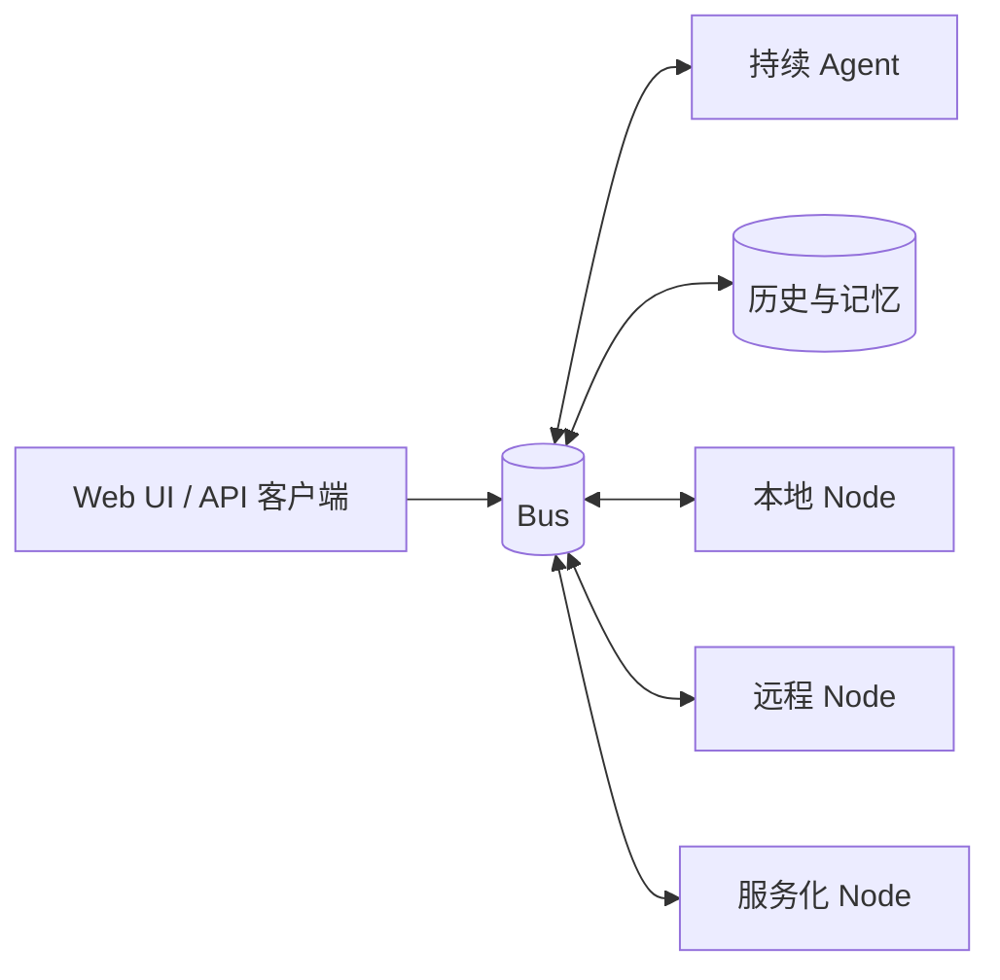

# NodeAgentOS

[English](README.md) | [中文](README.zh-CN.md)


**一个持续运行的 Agent 操作系统。** 一个 Agent、一个持续 session，Node 可以从任何地方接入总线。
它今天跑在你的电脑上，同一套 runtime 契约也为多租户云端而设计。

## 1. Setup

需要 Node 23.6 或更新版本（`.nvmrc` 和 CI 使用 24）以及 npm。

### a. npx

```bash
npx @node-agent/local
# 打开 http://127.0.0.1:8790/
```

### b. Docker

```bash
# 本地：只启动 stack，页面在 127.0.0.1:8790
cp deploy/env.example deploy/.env                         # 填入一个 token
docker compose -f deploy/docker-compose.yml up -d --build

# 公网：同一个 stack，外加 Caddy 处理 80/443 和证书
# （需要在 deploy/.env 里设置 NODE_AGENT_ACCESS_TOKEN 和 NODE_AGENT_DOMAIN）
docker compose -f deploy/docker-compose.yml --profile public up -d
```

## 2. NodeAgentOS 的特点

### 2.1 单 Agent 为中心，单一 session

NodeAgentOS 的核心是一个持续存在的 Agent，而不是每个标签页一个助手的聊天产品。

- **单一 session。** 没有 per-chat workspace，也不会为每个任务 fork 一份 Agent。每个页面、每条消息、
  每个定时器面对的都是同一个 Agent，共享同一份记忆和工作上下文。
- **单一身份。** notes、todo、history、工具和权限都属于这个 Agent，而不属于某一次临时对话。
- **持续服务。** Agent 不依赖某个页面或一次会话：它可以在定时器上醒来、接收 Node 发来的消息，
  或在 UI 关闭后继续任务。重启进程不会创造一个新的人格。

这就是“打开一个聊天窗口”和“有一个一直在的助手”的区别。

### 2.2 天生为云端设计

一个 7×24 小时在线的个人 Agent，不能住在一台会合盖休眠的笔记本里。它需要跑在云端：一直在线、
从任何地方都能连上，并且与其他用户彼此隔离。NodeAgentOS 是围绕这个前提设计的，而不是围绕一个
本地 demo。

- **所有组件都服务化。** bus、runtime、agent 和 Node 都是有明确契约的独立进程。开发时可以跑在同一台
  机器上，之后可以拆到不同主机，而模型不变。
- **多租户是结构的一部分。** 用户是访问关系，不是全局单例。同一个 runtime 要能承载很多用户，
  每个用户拥有一个持续 Agent 和一组独立的 Node。
- **网络优先。** Node 通过网络连接 Agent，而不是靠进程内 import。Node 可以在另一个容器、另一个
  机房，甚至另一家公司的基础设施里。
- **持续服务。** 浏览器关闭后，定时器、Node 发来的事件和未完成的任务仍然继续。

### 2.3 扩展能力：Node 是网络服务

扩展的单位是 **Node**：一个向 Agent 暴露能力的小包。

- **天然隔离。** 每个 Node 都是独立的进程或 worker，只能通过总线上的统一协议与系统其他部分
  交流。Node 之间不 import、不共享内存、不调用彼此的内部实现。一个 Node 故障、重启或迁移，
  不会把 Agent 一起拖垮。
- **连接多设备、多应用。** 台式机、笔记本、手机或一个应用后端，都可以作为 Node 通过 WebSocket
  接入。Agent 看到的是能力，而不是需要嵌进核心的代码。
- **双向通信。** Agent 可以调用 Node 的能力，Node 也可以调用另一个 Node，或把事件推回 Agent。
- **持续扩展。** Node 在 manifest 里声明自己的能力，Agent 在运行时发现这份 manifest。增加一个
  设备或一个应用，不需要重建核心。

这让系统可以持续扩展，而 Agent 不会变成巨石。

### 2.4 OS 级能力

一个有用的操作系统不只是能运行程序，还要给程序稳定的接口。NodeAgentOS 用同样的思路对待 Agent 扩展：

| 接口 | 提供什么 |
|---|---|
| **UI** | Node 可以贡献页面、panel 和 action；路由、布局和外壳由宿主负责。 |
| **国际化** | Node 以资源形式提供文案；runtime 解析读者语言，所有界面跟随。 |
| **持久化存储** | 对话记录、notes 和长期状态走 runtime 和 history 层，而不是每个 Node 自己藏文件。 |
| **权限** | Node 的每个 capability 声明 callers；runtime 按用户和 Agent 授予访问关系，决定谁可以调用哪个 Node。 |

这些接口决定了它只是一组工具，还是一个工具可以长期生活的平台。

## 3. 架构



总线是唯一的共享面，每个进程都是它的客户端。

| 层 | 职责 |
|---|---|
| **bus** (`node_agent/bus`) | 一个 WebSocket 端点；envelope 承载调用、事件和流 |
| **runtime** (`node_agent/runtime`) | 启动总线和 Node，并记录哪个用户可以使用哪个 Node |
| **agent** (`node_agent/nodes/agent`) | 唯一的持续 Agent：上下文、记忆、工具和模型循环 |
| **nodes** (`node_agent/nodes/*`) | 小而专注的能力包：history、shell、search、notes、todo、timer、system、webui |
| **sdk** (`node_agent/sdk`) | manifest schema、wire 类型和 Node runner |

## 4. Node 契约

Node 是一个带 `node` manifest 和入口文件的 npm 包。它不 import 另一个 Node；它通过总线到达系统其他部分。

```json
{
  "name": "my-node",
  "node": {
    "id": "my-node",
    "desc": "一个 Agent 可以调用的能力",
    "entry": "dist/index.js",
    "caps": {
      "hello": {
        "type": "object",
        "callers": ["agent"]
      }
    }
  }
}
```

把它接到一个正在运行的总线上：

```bash
NODE_AGENT_BUS_URL=ws://127.0.0.1:8788 \
NODE_AGENT_TOKEN=your-token \
NODE_AGENT_TENANT=default \
node-agent-sdk .
```

`node_example/hello-node` 是一个完整可运行的例子，[docs/node-authoring.md](docs/node-authoring.md)
会带你走一遍 manifest、SDK runner 和 Node 之间的调用路径。

## 5. Development

```bash
npm install          # workspace 包 + npm 上的 @node-agent/sdk
npm run build        # 按依赖顺序构建所有 workspace
npm test             # 先构建，再运行每个 workspace 的测试
```

参见 [docs/quickstart.md](docs/quickstart.md)、[docs/architecture.md](docs/architecture.md)、
[docs/security.md](docs/security.md) 和 [docs/deployment.md](docs/deployment.md)。

## 📄 License

MIT License。见 [LICENSE](LICENSE)。

每个发布的 workspace 包都带有 npm 需要的 license 副本；副本漂移时 `npm run licenses:check` 会失败。
